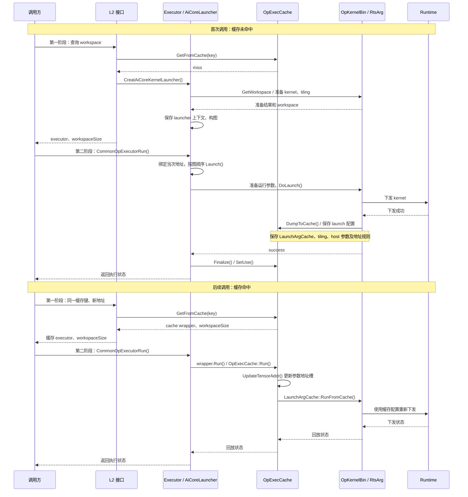
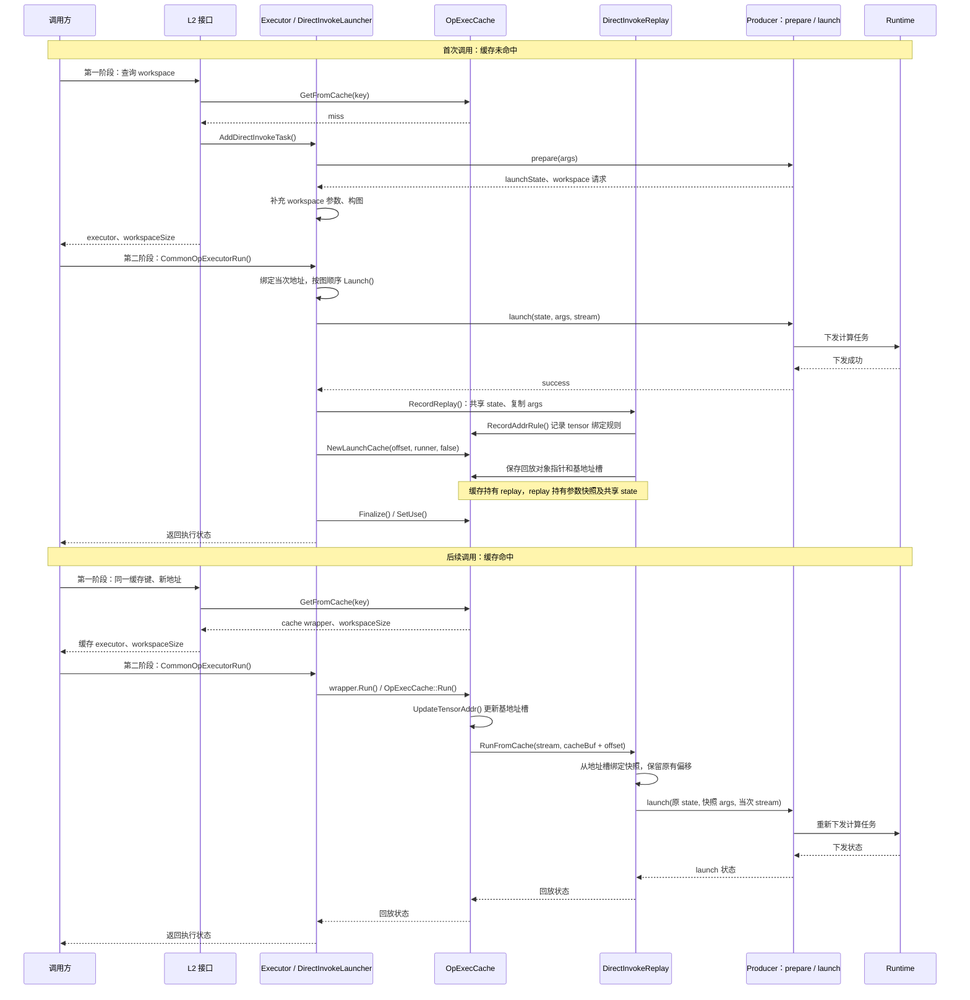

# AddDirectInvokeTask

通过三个生命周期回调将计算任务加入 executor。头文件为 `opdev/direct_invoke_task.h`。

```cpp
aclnnStatus op::AddDirectInvokeTask(
    const char* l0Name, uint32_t opType,
    DirectInvokePrepareFn prepare,
    DirectInvokeLaunchFn launch,
    DirectInvokeDestroyFn destroy,
    aclOpExecutor* executor, OpArgContext* args);
```

## 回调与生命周期

- `prepare(args, workspaceRequest, launchState)` 在注册时同步执行。实现选择、tiling、工作区大小等每次调用的输入均来自 `args`。算子专属回调可以引用不可变的实现元数据。
- `launch(launchState, args, stream)` 在执行时提交计算，可包含多个设备任务。最终输入、输出和工作区地址从本次 `args` 读取。
- `destroy(launchState)` 在注册失败或最后一个 launcher/缓存所有者释放时销毁非空状态，包含 prepare 失败返回的部分状态；每个状态恰好释放一次。无状态任务可返回空状态，此时不调用 destroy。

三个回调都必须非空且为 `noexcept`。opbase 将 workspace 请求初始化为 `{nullptr, 0, 0}`、状态初始化为空。
`DirectInvokeWorkspaceRequest` 的每个大小对应一个 executor 分配的工作区 tensor，由 opbase 负责对齐和内存复用。
大小数组必须在注册返回前保持有效，例如由 launchState 持有，不能指向 prepare 栈变量。

`args` 必须由 `GetOpArgContext` 创建，所有注册返回路径都由 opbase 消费。
允许空的可选输入 tensor，输出不能空；入口的 workspace 参数列表必须为空或不存在。
回调模块应覆盖 executor 及缓存项的生命周期，异步设备任务使用的代码和资源还必须存活到设备执行完成；destroy 不是设备完成通知。

## 计算、缓存与 DFX 契约

任务统一为计算任务，内部使用与设备引擎无关的 `DIRECT_INVOKE` 分类，不声明 AiCore/AiCpu/Dvpp。
opbase 保留输入输出 dump、适用的 overflow 检查，不在回调边界上报 profiling；具体设备任务 profiling 由实际下发路径处理。

DirectInvoke 与 AiCore 使用同一套 L2 key、OpExecCache、workspace 内存规划和缓存发布/淘汰机制。
区别在于准备结果和下发逻辑的表示方式，不引入独立的缓存策略或实现注册表。

| 环节 | AiCore | DirectInvoke |
| --- | --- | --- |
| 一阶段准备 | tiling、kernel 选择、workspace 规划 | prepare 生成 launchState，并请求 workspace |
| 缓存持有的数据 | LaunchArgCache 中的下发配置、tiling 和 host 参数 | 回放对象指针与基地址槽；缓存独立持有 launchState 和参数快照 |
| 地址关系 | AddLaunchTensor 独立记录地址规则，回放时更新 runtime 参数槽位 | RecordAddrRule 生成基地址槽规则，回放时直接绑定快照，保留 view/storage/workspace 偏移 |
| 命中执行 | RunFromCache 恢复运行时参数并下发 | RunFromCache 读取基地址槽，使用同一 launchState 调用 launch(state, args, stream) |
| 生效与淘汰 | 框架 Finalize/SetUse 和缓存管理器 | 复用同一流程；最后一个所有者释放 state |

### 首次执行与命中

1. L2 按既有规则查找缓存。命中时直接返回缓存 executor，不再构图，也不调用 prepare。
2. 未命中时，prepare 同步产生与地址无关的准备状态；opbase 分配 workspace tensor，并加入现有计算图。
3. 二阶段绑定最终地址并调用 launch。成功后记录一次回放任务，缓存持有参数快照和共享状态；
   executor 完成后由既有流程发布缓存。失败沿用现有执行错误处理，不发布可用的部分任务序列。
4. 后续命中使用本次输入输出 storage 地址、workspace 和 stream 回放，跳过 prepare。
   同一队列中的 AiCore 任务和 DirectInvoke 任务保持首次执行记录的顺序；普通 L2 缓存命中路径中，回放失败立即返回，不再 fallback 重复提交。
5. 显式 repeat executor 使用同一准备状态。缓存不可用时仍可走 launcher，是否允许 repeat 由原有框架规则决定；
   已发布的缓存不能因再次走 launcher 而追加任务。

### 缓存调用时序对比

以下展示可缓存任务首次执行成功及后续 L2 命中的路径，省略参数检查、部分 DFX 和错误分支。
AiCore 一阶段以需要查询 workspace 的分支为例。图中的 runtime 返回表示下发结果，不表示设备计算已经完成。

#### AiCore



#### DirectInvoke



两条路径复用同一套 L2 缓存查找、任务顺序和发布/回收机制。命中后，AiCore 更新 runtime 参数地址槽，
DirectInvoke 重绑定参数快照中的 tensor 地址；二者都跳过一阶段准备，并使用当次 stream 重新下发任务。
混合任务按首次执行记录的顺序回放。在上述普通 L2 缓存命中路径中，任何任务回放失败均立即返回。
显式 repeat executor 保持框架原有失败处理行为，不在上述“不重复提交”的保证范围内。

### 回放记录与 DFX 边界

AiCore 和 DirectInvoke 均沿用 `offset + runner` 回放机制，每条任务都有真实的回放函数。
DirectInvoke 的缓存缓冲区仅保存回放对象指针和基地址槽；参数快照及共享 state 由 OpExecCache
独立持有，Finalize 按字节复制或移动缓冲区不改变对象所有权。地址槽只保存 storage/workspace
基地址，快照保留 viewOffset、storageOffset 和 workspaceOffset，避免重复叠加偏移。
AiCore 的 AddLaunchTensor 保持独立实现。

每个 Task 保存 `offset`、真实 `runner` 和已有的 `op::CoreType` 类型标记。AiCore 默认使用
`op::AI_CORE`，沿用原有 DFX 数组、填充接口及释放逻辑。DirectInvoke 使用 `op::DIRECT_INVOKE`，
上下文由 DirectInvokeReplay 保存并由 runner 恢复，设备任务上报由实际下发路径负责。
不额外引入 CachedTaskDfx、任务 ID 或平行 taskHasDfx 标记数组。

回放按统一任务队列顺序执行，但只有 AiCore 任务消费并推进原有 DFX 数组索引；
DirectInvoke 任务不占用 DFX 数组条目。下发失败仍立即返回，不执行后续任务，
AiCore 任务的 profiling guard 在失败返回时正常收尾。
普通 dump、异常 dump、overflow、参数记录和 level2 profiling 继续遵循原有 CheckCacheable 限制。

### state 与参数快照的职责

launch 所需信息由 **launchState、当前 args 和 stream** 共同提供。
launchState 对应 AiCore 的 tiling/下发准备结果，缓存直接共享它，不重新解释或复制内部结构。
参数快照保存支持的参数值和 tensor 的 shape、stride、dtype、format、offset；
执行时只重绑定地址，不要求保留原 tensor/aclStorage 对象的身份。
对无法复制的参数类型或无法建立的地址关系，框架放弃本次缓存，正常 launch 仍执行。

- prepare 的动态输入来自 args，并由调用它的 L2 API 纳入既有缓存 key；与 AiCore 一样，相同 key 应对应等价的准备结果。
- launchState 不保存待重绑定的输入输出/workspace 地址，也不借用 args、tensor 描述或属性容器的指针。
- 可复用任务的 launch 将参数元信息视为只读；所有任务均在本次调用中读取最终地址，不在返回后继续访问 args 或其描述对象。
- 同一 state 可跨 executor、多次 launch 复用，计算语义不能依赖此前 launch 的次数；调用级临时数据放在本次 workspace 或局部变量中。
- 与 AiCore 缓存一样，同一个缓存项不支持并发执行；DirectInvoke 不额外提供共享 state 的并发同步。
- 动态输出形状及现有 DFX 等框架限制仍可禁止缓存或 repeat，注册不会重新启用已禁止的复用。
- destroy 在最后一个 launcher/缓存所有者释放时恰好执行一次，可能由缓存 GC 线程调用；不能依赖注册线程的 TLS 或隐含的当前 device context。
- state 的所有权不代表设备任务已完成；异步下发依赖的资源和回调模块仍由 producer 保证有效期。

## 接口迁移

原任务描述结构、taskConfig、引擎类型和 producer 缓存策略已移除。
调用方直接传入三个回调，原先通过 taskConfig 传入的静态 descriptor 可由算子专属 prepare 回调引用；每次调用变化的数据应编码为常规 `args` 参数。
本次为不兼容接口变更，调用方及 opbase 必须一起重新编译，不保留旧接口别名。
